


&nbsp;&nbsp;&nbsp;

 



 


<a href="https://useveyra.co"></a>

<a href="https://apps.apple.com/us/app/veyra-video-subtitles/id6813860542">App Store</a> &nbsp;·&nbsp; <a href="https://play.google.com/store/apps/details?id=com.gosoftware.veyra">Google Play</a> &nbsp;·&nbsp; <a href="https://useveyra.co">useveyra.co</a>

<a href="https://shopp.krd"></a>

<a href="https://gosoftware.krd"></a>

 


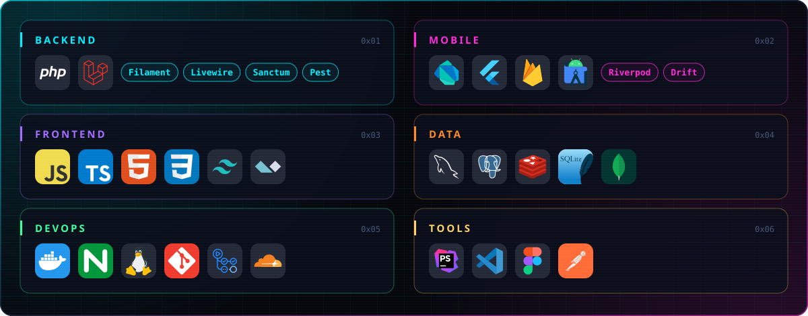

 


<picture>
  <source media="(prefers-color-scheme: dark)" srcset="https://raw.githubusercontent.com/ahmadnajmdev/ahmadnajmdev/output/snake-dark.svg">
  <source media="(prefers-color-scheme: light)" srcset="https://raw.githubusercontent.com/ahmadnajmdev/ahmadnajmdev/output/snake-light.svg">
  
</picture>

 


Have a product idea? I build web and mobile products end to end with <b><a href="https://gosoftware.krd">GO Software</a></b>, from the first database table to the App Store release.

<a href="https://gosoftware.krd">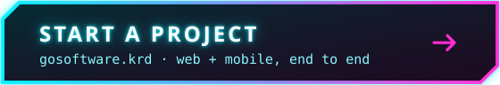</a>

 


